**COMPUTING PROJECT**

**SOFTWARE DESIGN DOCUMENT**

**Rancang Bangun Website Company Profile dan Sistem Reservasi Studio Foto Berbasis Web dengan Fitur Chatbot menggunakan Algoritma Levenshtein pada Sejenak Studio Purwokerto**

**Project Manager**

Ibnu Rizal Mutaqim - 2311102067

**Team Members**

Bintang Yudhistira - 2311102052  
Muhammad Nasrulloh - 2311102044  
Muhammad Agha Zulfadhli - 2311102015  
Anita Nurazizah Agussalim - 2311102017  
Hendwi Saputra - 2311102218

**Supervisor**

Amalia Beladinna Arifa, S.Pd., M.Cs.

**PROGRAM STUDI S-1 TEKNIK INFORMATIKA**  
**DIREKTORAT KAMPUS PURWOKERTO - UNIVERSITAS TELKOM**  
**MARET 2026**

# Document Version

| Versi | Tanggal       | Perubahan                                                                 | Penulis        |
| ----- | ------------- | ------------------------------------------------------------------------- | -------------- |
| 1.0   | 14 April 2026 | Penyusunan awal Software Design Document berdasarkan implementasi project | Tim Kelompok 1 |

# Table of Content

1. [Introduction](#1-introduction)
2. [System Architecture Design](#2-system-architecture-design)
3. [Module Design](#3-module-design)
4. [Class Diagram and Object Design](#4-class-diagram-and-object-design)
5. [Database Design](#5-database-design)
6. [User Interface Design (UI/UX)](#6-user-interface-design-uiux)
7. [Data Flow and Process Flow](#7-data-flow-and-process-flow)
8. [System Constraints](#8-system-constraints)
9. [Appendix](#9-appendix)

# 1. Introduction

## 1.1 Purpose

Dokumen Software Design Document (SDD) ini disusun untuk menjelaskan rancangan teknis dari aplikasi website company profile dan sistem reservasi Sejenak Studio Purwokerto. Dokumen ini menjadi acuan implementasi bagi tim pengembang, bahan komunikasi dengan dosen pembimbing, serta dasar evaluasi kesesuaian antara kebutuhan sistem dengan hasil implementasi.

Secara khusus, dokumen ini menjelaskan arsitektur aplikasi, pembagian modul, desain kelas dan objek, rancangan basis data, rancangan antarmuka, serta alur proses utama. Dokumen ini juga membantu proses maintenance, pengembangan lanjutan, dan penyusunan laporan akademik karena setiap keputusan desain dijelaskan secara terstruktur.

## 1.2 Scope of the System

Sistem yang dibangun adalah aplikasi web untuk Sejenak Studio Purwokerto yang menyediakan fungsi company profile, katalog paket layanan, galeri foto, informasi studio, form reservasi online, panel admin, serta chatbot FAQ berbasis algoritma Levenshtein. Pengguna utama sistem terdiri dari pengunjung umum atau calon pelanggan dan admin studio. Pengunjung menggunakan sistem untuk melihat profil studio, meninjau paket, melihat galeri, melakukan reservasi, serta bertanya melalui chatbot. Admin menggunakan sistem untuk login, memantau reservasi, mengelola paket layanan, mengelola konten galeri, serta memperbarui data FAQ yang menjadi basis pengetahuan chatbot.

Manfaat utama dari sistem ini adalah mempermudah promosi studio secara online, mempercepat proses booking, mengurangi pertanyaan berulang melalui chatbot, dan membantu admin mengelola data studio secara terpusat. Platform yang digunakan adalah aplikasi web berbasis browser yang dapat diakses melalui desktop maupun perangkat mobile selama tersedia koneksi internet dan web server aktif.

## 1.3 References

Referensi yang digunakan pada penyusunan desain ini adalah sebagai berikut.

1. Dokumen kebutuhan sistem atau SRS project Sejenak Studio Purwokerto.
2. Implementasi source code project pada framework Laravel 12.
3. Standar routing, MVC, migration, dan Eloquent ORM dari dokumentasi Laravel.
4. Pedoman desain antarmuka berbasis Bootstrap 5.3.
5. Konsep string similarity menggunakan algoritma Levenshtein untuk pencocokan pertanyaan chatbot.
6. Struktur basis data aktual pada folder `database/migrations`.

# 2. System Architecture Design

## 2.1 Use Case Diagram

Berikut adalah gambaran use case utama yang merepresentasikan fitur sistem.

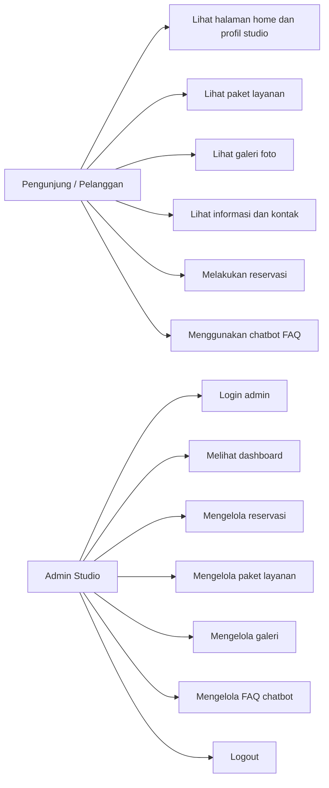

## 2.2 High-Level Architecture Diagram

Arsitektur sistem menggunakan pola MVC dari Laravel. Lapisan presentasi dibangun menggunakan Blade template, Bootstrap, CSS, dan JavaScript sederhana. Lapisan backend menggunakan controller Laravel untuk menangani request, validasi, dan logika bisnis. Lapisan data menggunakan MySQL melalui Eloquent ORM dan migration. Chatbot tidak menggunakan API AI eksternal, melainkan mesin pencocokan lokal berbasis data FAQ dan algoritma Levenshtein di sisi backend.

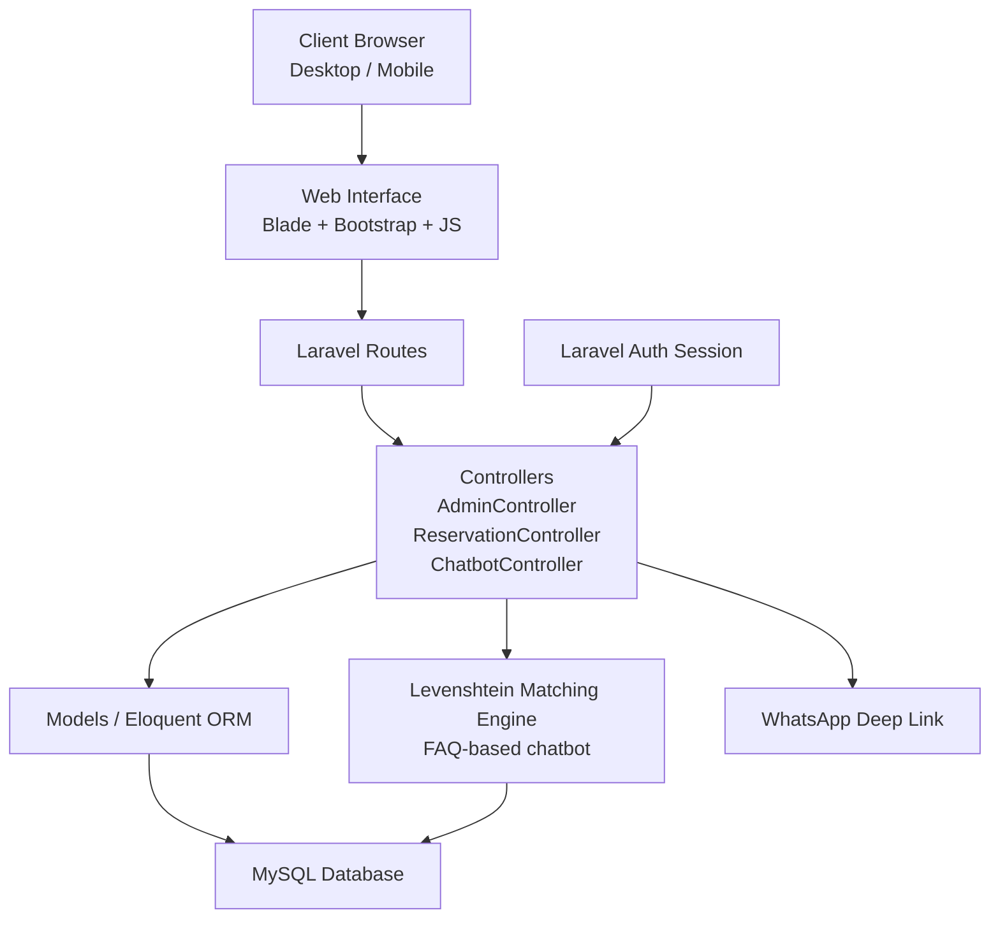

Komponen arsitektur tingkat tinggi dapat dijelaskan sebagai berikut.

| Komponen              | Deskripsi                                                                                                     |
| --------------------- | ------------------------------------------------------------------------------------------------------------- |
| Frontend              | Blade view publik, view admin, Bootstrap 5, Font Awesome, JavaScript fetch API pada chatbot                   |
| Backend               | Laravel 12, routing web, controller, validasi form, session authentication                                    |
| Database              | Tabel `users`, `service_packages`, `reservations`, `galleries`, `faqs`, serta tabel bawaan `cache` dan `jobs` |
| External API          | Tidak ada API eksternal untuk chatbot; integrasi eksternal hanya berupa tautan WhatsApp `wa.me`               |
| Authentication Server | Menggunakan mekanisme autentikasi bawaan Laravel berbasis session dan tabel `users`                           |
| AI/ML Engine          | Tidak memakai model AI generatif; chatbot menggunakan string matching Levenshtein + word overlap              |

## 2.3 Deployment Architecture

Berdasarkan implementasi project, sistem dirancang untuk dijalankan sebagai aplikasi web server-side berbasis Laravel pada lingkungan development lokal atau hosting PHP standar. Arsitektur deployment terdiri dari browser sebagai client, web server PHP sebagai application server, dan MySQL sebagai database server. Pada fase pengembangan, server dapat dijalankan melalui `php artisan serve` dan aset front-end dibangun dengan Vite.

Project ini belum menunjukkan implementasi Docker, Kubernetes, atau pipeline CI/CD khusus. Dengan demikian, deployment saat ini lebih sesuai dikategorikan sebagai deployment sederhana pada shared hosting, VPS, atau server lokal kampus. Seluruh proses request diproses di server dan hasilnya dikembalikan ke client dalam bentuk HTML atau JSON.

# 3. Module Design

## 3.1 Module List

Modul-modul utama yang terdapat dalam sistem adalah:

1. Public Content Module
2. Reservation Module
3. Chatbot Module
4. Authentication Module
5. Admin Dashboard Module
6. Service Package Management Module
7. Gallery Management Module
8. FAQ Management Module

## 3.2 Module Description

### 3.2.1 Public Content Module

| Komponen   | Deskripsi                                                              |
| ---------- | ---------------------------------------------------------------------- |
| Nama Modul | Public Content Module                                                  |
| Tujuan     | Menyajikan informasi company profile studio kepada pengunjung          |
| Input      | Request halaman home, profil, paket, galeri, informasi, kontak         |
| Output     | Tampilan halaman publik berbasis Blade                                 |
| Dependency | `routes/web.php`, model `ServicePackage`, model `Gallery`, view publik |
| Catatan    | Home menampilkan 3 paket unggulan dan 6 galeri terbaru                 |

Tanggung jawab modul ini adalah menampilkan identitas studio, paket layanan, galeri, informasi umum, dan kontak. Modul ini bersifat read-only untuk pengunjung umum.

### 3.2.2 Reservation Module

| Komponen   | Deskripsi                                                                                  |
| ---------- | ------------------------------------------------------------------------------------------ |
| Nama Modul | Reservation Module                                                                         |
| Tujuan     | Menerima, memvalidasi, dan menyimpan data reservasi pelanggan                              |
| Input      | Nama, nomor HP, paket, background, tanggal, jam, jumlah orang, catatan                     |
| Output     | Data reservasi tersimpan dan redirect ke halaman sukses dengan link WhatsApp               |
| Dependency | `ReservationController`, model `Reservation`, model `ServicePackage`, tabel `reservations` |
| Catatan    | Memiliki validasi bentrok jadwal dan validasi kapasitas paket                              |

Logika internal modul reservasi:

1. Menampilkan daftar paket pada form reservasi.
2. Melakukan validasi seluruh input.
3. Mengecek konflik jadwal berdasarkan kombinasi tanggal dan jam dengan status `pending` atau `confirmed`.
4. Mengecek apakah jumlah orang melebihi `max_people` pada paket.
5. Menyimpan data reservasi dengan status awal `pending`.
6. Membentuk pesan WhatsApp otomatis untuk konfirmasi ke admin.

Strategi penanganan error:

1. Validasi form menggunakan `Request::validate`.
2. Jika slot bentrok, sistem mengembalikan error ke form.
3. Jika jumlah orang melebihi kapasitas paket, sistem menolak penyimpanan dan menampilkan pesan kesalahan.

### 3.2.3 Chatbot Module

| Komponen   | Deskripsi                                                                  |
| ---------- | -------------------------------------------------------------------------- |
| Nama Modul | Chatbot Module                                                             |
| Tujuan     | Menjawab pertanyaan umum pelanggan secara otomatis                         |
| Input      | Pesan teks dari pengguna                                                   |
| Output     | Respons JSON berisi jawaban chatbot, skor kecocokan, dan FAQ yang cocok    |
| Dependency | `ChatbotController`, model `Faq`, tabel `faqs`, JavaScript fetch API       |
| Catatan    | Menggunakan algoritma Levenshtein dan word overlap, tanpa API AI eksternal |

Logika internal chatbot:

1. Menormalisasi input pengguna ke huruf kecil.
2. Mengecek sapaan sederhana seperti `halo`, `hai`, atau `hello`.
3. Mengambil seluruh data FAQ dari database.
4. Menghitung skor kemiripan tiap pertanyaan FAQ dengan kombinasi:
   a. Similarity Levenshtein string penuh.  
   b. Word overlap dengan toleransi typo 1 karakter per kata.
5. Memilih FAQ dengan skor tertinggi.
6. Memberikan jawaban jika skor melebihi threshold 0.25.
7. Menampilkan fallback message jika tidak ada pertanyaan yang cukup mirip.

Strategi penanganan error:

1. Jika input kosong, sistem meminta pengguna mengetik pertanyaan.
2. Jika database FAQ kosong, bot mengarahkan pengguna untuk menghubungi admin.
3. Jika request AJAX gagal, UI menampilkan pesan gangguan koneksi.

### 3.2.4 Authentication Module

| Komponen   | Deskripsi                                                               |
| ---------- | ----------------------------------------------------------------------- |
| Nama Modul | Authentication Module                                                   |
| Tujuan     | Mengamankan akses halaman admin                                         |
| Input      | Email dan password admin                                                |
| Output     | Session login dan redirect ke dashboard admin                           |
| Dependency | `AdminController@login`, middleware `auth`, model `User`, tabel `users` |
| Catatan    | Login dilakukan manual dengan `auth()->attempt()`                       |

Modul ini bertanggung jawab terhadap login admin, regenerasi session, proteksi route admin, dan logout.

### 3.2.5 Admin Dashboard Module

| Komponen   | Deskripsi                                                            |
| ---------- | -------------------------------------------------------------------- |
| Nama Modul | Admin Dashboard Module                                               |
| Tujuan     | Menyajikan ringkasan statistik operasional studio                    |
| Input      | Data reservasi dan paket dari database                               |
| Output     | Halaman dashboard dengan statistik dan reservasi terbaru             |
| Dependency | `AdminController@index`, model `Reservation`, model `ServicePackage` |
| Catatan    | Statistik utama: total booking, pending, confirmed, total paket      |

### 3.2.6 Service Package Management Module

| Komponen   | Deskripsi                                                 |
| ---------- | --------------------------------------------------------- |
| Nama Modul | Service Package Management Module                         |
| Tujuan     | Mengelola data paket layanan studio                       |
| Input      | Nama paket, deskripsi, harga, kapasitas maksimal          |
| Output     | Data paket tersimpan, diperbarui, atau dihapus            |
| Dependency | `AdminController` package methods, model `ServicePackage` |
| Catatan    | Operasi CRUD tersedia pada panel admin                    |

### 3.2.7 Gallery Management Module

| Komponen   | Deskripsi                                                                            |
| ---------- | ------------------------------------------------------------------------------------ |
| Nama Modul | Gallery Management Module                                                            |
| Tujuan     | Mengelola foto galeri berdasarkan kategori                                           |
| Input      | Judul, kategori, file gambar                                                         |
| Output     | Data galeri tersimpan atau dihapus                                                   |
| Dependency | `AdminController` gallery methods, model `Gallery`, folder `public/images/galleries` |
| Catatan    | Maksimal 5 foto per kategori                                                         |

Strategi penanganan error pada modul galeri:

1. Validasi file image dilakukan di controller.
2. Jika jumlah foto pada kategori mencapai 5, sistem menolak penambahan baru.
3. Jika tidak ada file diunggah, sistem menggunakan nama gambar default.

### 3.2.8 FAQ Management Module

| Komponen   | Deskripsi                                                |
| ---------- | -------------------------------------------------------- |
| Nama Modul | FAQ Management Module                                    |
| Tujuan     | Mengelola basis pengetahuan yang digunakan chatbot       |
| Input      | Pertanyaan dan jawaban FAQ                               |
| Output     | Data FAQ tersimpan, diperbarui, atau dihapus             |
| Dependency | `AdminController` FAQ methods, model `Faq`, tabel `faqs` |
| Catatan    | Perubahan data FAQ langsung memengaruhi respons chatbot  |

# 4. Class Diagram and Object Design

## 4.1 Class Diagram

Class diagram berikut merepresentasikan struktur kelas inti pada implementasi.

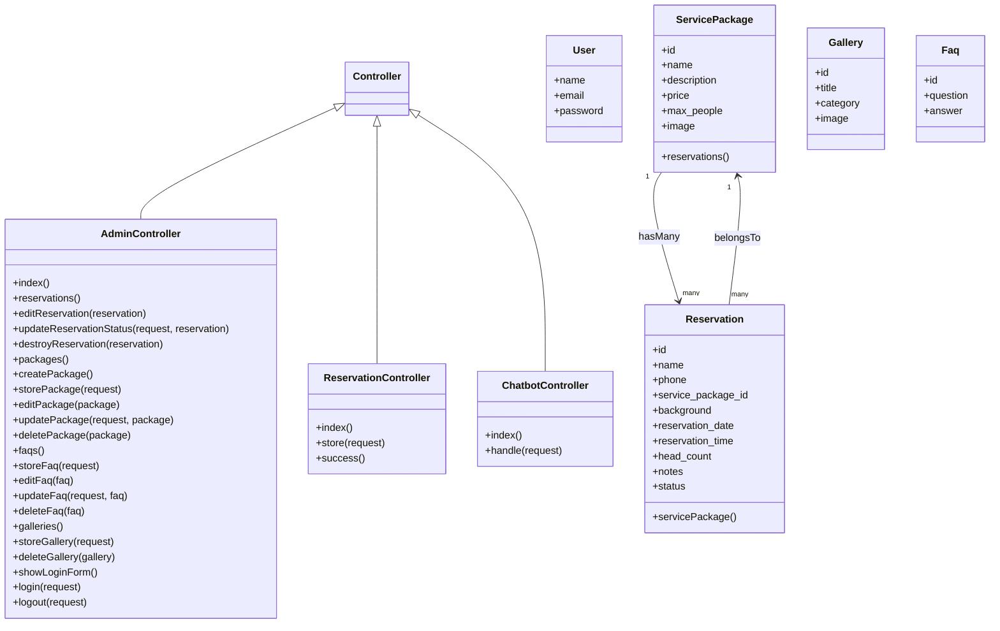

## 4.2 Object Interaction

### 4.2.1 Sequence Diagram Login Admin

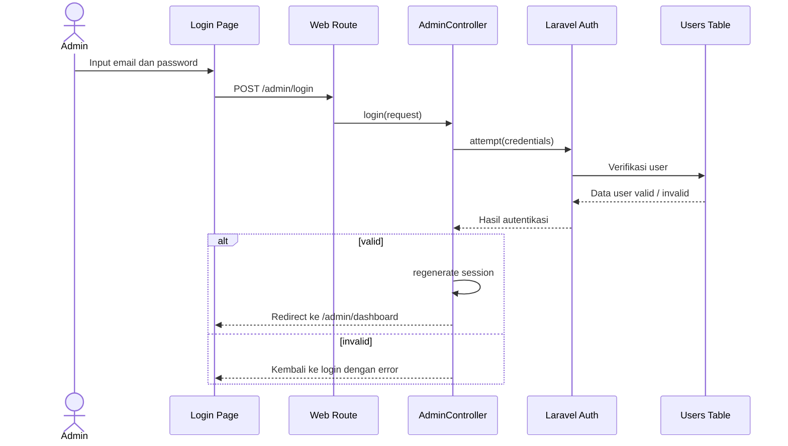

### 4.2.2 Sequence Diagram Proses Reservasi

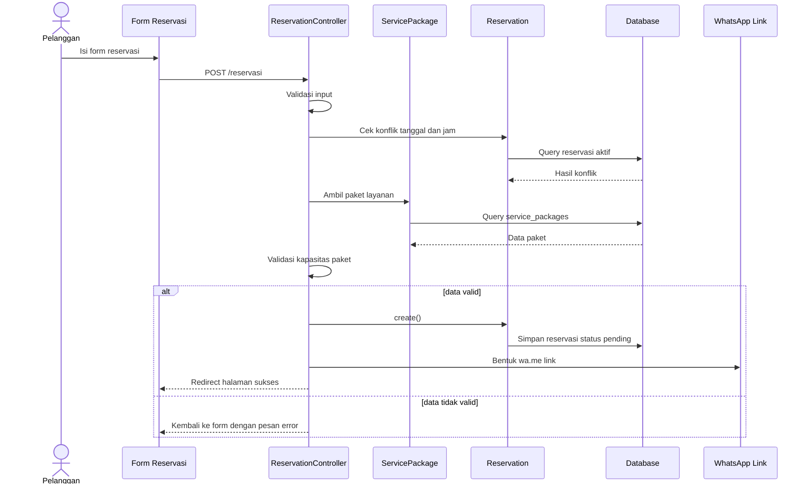

### 4.2.3 Sequence Diagram Chatbot FAQ

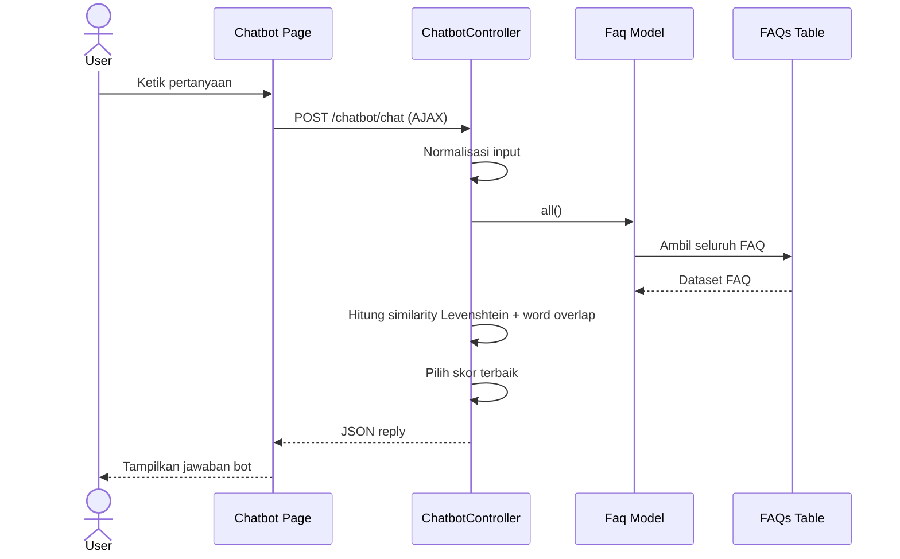

# 5. Database Design

## 5.1 Entity Relationship Diagram (ERD)

ERD utama pada sistem yang dibangun adalah sebagai berikut.

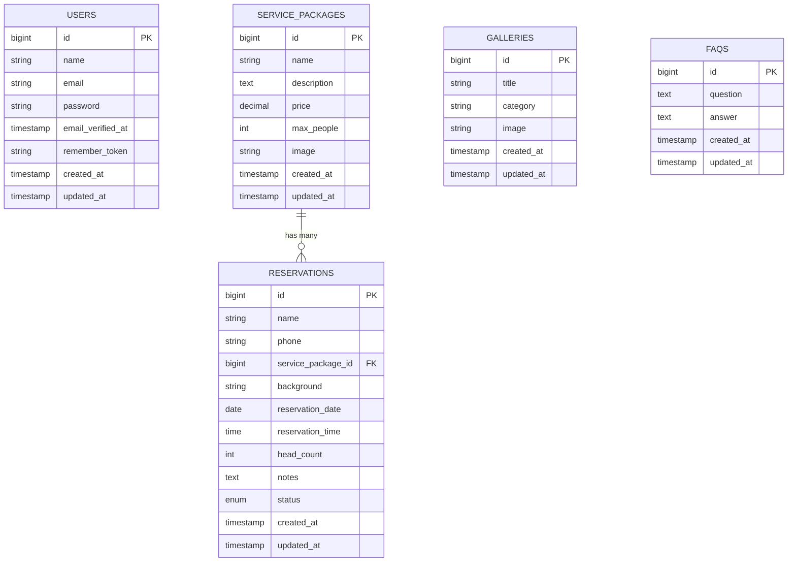

## 5.2 Database Schema Definitions

### 5.2.1 Table `users`

| Field             | Type               | Description             |
| ----------------- | ------------------ | ----------------------- |
| id                | bigint             | Primary key user admin  |
| name              | varchar            | Nama admin              |
| email             | varchar            | Email admin untuk login |
| email_verified_at | timestamp nullable | Waktu verifikasi email  |
| password          | varchar            | Password terenkripsi    |
| remember_token    | varchar nullable   | Token remember me       |
| created_at        | timestamp          | Waktu pembuatan data    |
| updated_at        | timestamp          | Waktu perubahan data    |

### 5.2.2 Table `service_packages`

| Field       | Type             | Description            |
| ----------- | ---------------- | ---------------------- |
| id          | bigint           | Primary key paket      |
| name        | varchar          | Nama paket layanan     |
| description | text             | Deskripsi paket        |
| price       | decimal(12,2)    | Harga paket            |
| max_people  | integer          | Jumlah maksimal orang  |
| image       | varchar nullable | Nama file gambar paket |
| created_at  | timestamp        | Waktu pembuatan data   |
| updated_at  | timestamp        | Waktu perubahan data   |

### 5.2.3 Table `reservations`

| Field              | Type             | Description                                                |
| ------------------ | ---------------- | ---------------------------------------------------------- |
| id                 | bigint           | Primary key reservasi                                      |
| name               | varchar          | Nama pelanggan                                             |
| phone              | varchar          | Nomor WhatsApp pelanggan                                   |
| service_package_id | bigint FK        | Referensi ke tabel `service_packages`                      |
| background         | varchar nullable | Pilihan background foto                                    |
| reservation_date   | date             | Tanggal reservasi                                          |
| reservation_time   | time             | Jam reservasi                                              |
| head_count         | integer          | Jumlah orang dalam sesi                                    |
| notes              | text nullable    | Catatan tambahan pelanggan                                 |
| status             | enum             | Status reservasi: pending, confirmed, completed, cancelled |
| created_at         | timestamp        | Waktu pembuatan data                                       |
| updated_at         | timestamp        | Waktu perubahan data                                       |

### 5.2.4 Table `galleries`

| Field      | Type      | Description              |
| ---------- | --------- | ------------------------ |
| id         | bigint    | Primary key galeri       |
| title      | varchar   | Judul foto               |
| category   | varchar   | Kategori foto atau paket |
| image      | varchar   | Nama file gambar         |
| created_at | timestamp | Waktu pembuatan data     |
| updated_at | timestamp | Waktu perubahan data     |

### 5.2.5 Table `faqs`

| Field      | Type      | Description                      |
| ---------- | --------- | -------------------------------- |
| id         | bigint    | Primary key FAQ                  |
| question   | text      | Pertanyaan yang dikenali chatbot |
| answer     | text      | Jawaban yang dikirim chatbot     |
| created_at | timestamp | Waktu pembuatan data             |
| updated_at | timestamp | Waktu perubahan data             |

### 5.2.6 Tabel Bawaan Laravel

Selain tabel utama di atas, project ini juga memiliki tabel `cache` dan `jobs` dari migration bawaan Laravel untuk kebutuhan cache dan queue di level framework. Pada implementasi saat ini, kedua tabel tersebut belum menjadi inti fitur bisnis aplikasi.

# 6. User Interface Design (UI/UX)

## 6.1 Wireframes / Mockups

Karena project yang tersedia sudah berupa implementasi langsung, bagian ini dijelaskan berdasarkan halaman aktual yang ada pada sistem.

| Halaman                | Komponen Utama                                                                           | Deskripsi Singkat                                                                                                    |
| ---------------------- | ---------------------------------------------------------------------------------------- | -------------------------------------------------------------------------------------------------------------------- |
| Landing Page / Home    | Navbar, hero section, paket unggulan, preview galeri, testimoni, footer, tombol chatbot  | Halaman utama untuk promosi studio dan navigasi cepat ke reservasi                                                   |
| Login Page Admin       | Form email, password, tombol login                                                       | Digunakan admin untuk mengakses panel backend                                                                        |
| Dashboard Admin        | Kartu statistik, tabel reservasi terbaru, sidebar navigasi                               | Memberikan ringkasan kondisi operasional studio                                                                      |
| Input Page Reservasi   | Form identitas pelanggan, pilihan paket, background, tanggal, jam, jumlah orang, catatan | Digunakan pelanggan untuk membuat booking                                                                            |
| Reports Page ekuivalen | Halaman daftar reservasi admin                                                           | Pada implementasi saat ini belum ada laporan analitik khusus; daftar reservasi menjadi halaman pemantauan data utama |
| Chatbot Page           | Header chat, bubble message, quick replies, input area                                   | Media interaksi tanya jawab otomatis dengan pelanggan                                                                |

Deskripsi tampilan utama:

1. Halaman publik menggunakan identitas visual warna teal, kuning, putih, dan tipografi Poppins.
2. Antarmuka admin menggunakan layout sidebar tetap di kiri dan konten utama di sisi kanan.
3. Halaman chatbot didesain menyerupai percakapan instan dengan AJAX tanpa reload.
4. Form reservasi dibuat sederhana agar pelanggan dapat mengisi data booking dengan cepat.

Jika diperlukan untuk lampiran akhir, screenshot dari halaman-halaman tersebut dapat ditambahkan ke dokumen ini pada revisi berikutnya.

## 6.2 Navigation Flow

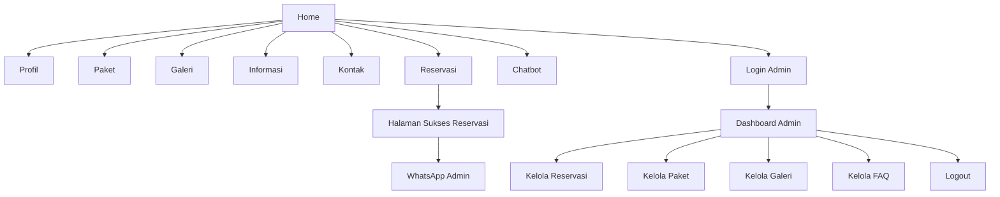

# 7. Data Flow and Process Flow

## 7.1 Data Flow Diagram (DFD)

### 7.1.1 DFD Level 0

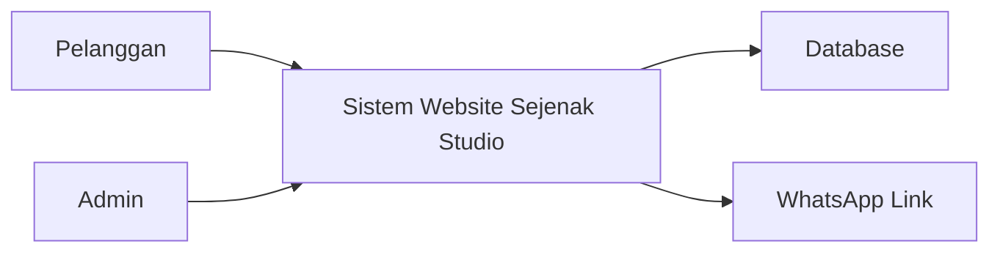

### 7.1.2 DFD Level 1

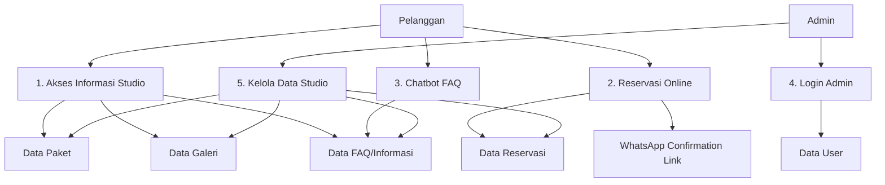

## 7.2 Activity Diagram

### 7.2.1 Activity Diagram Login Admin

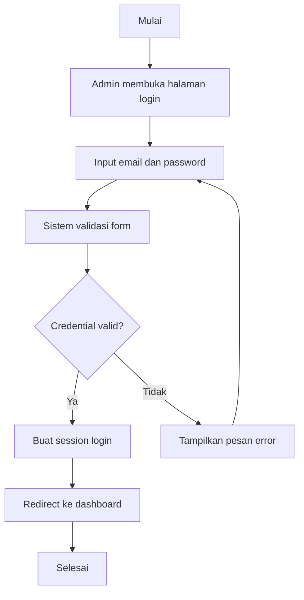

### 7.2.2 Activity Diagram Reservasi

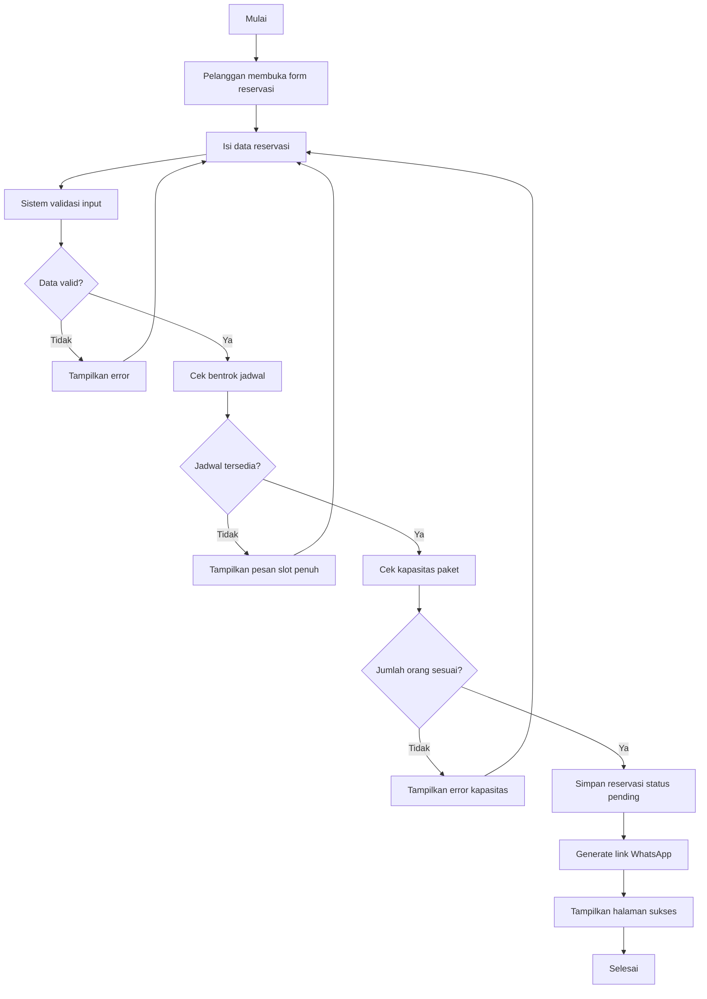

### 7.2.3 Activity Diagram Chatbot

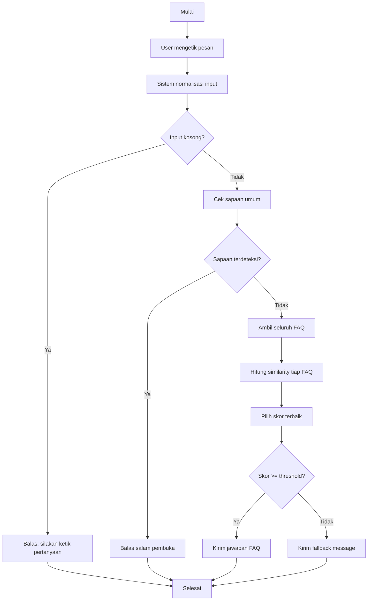

## 7.3 State Machine Diagram

Objek yang memiliki perubahan state pada sistem ini adalah `Reservation`.

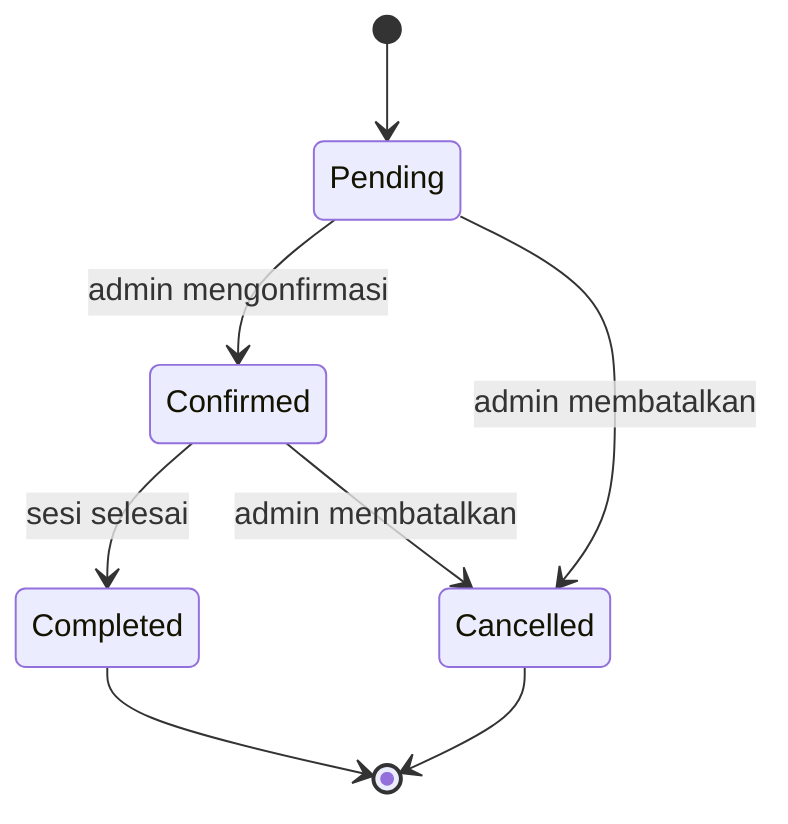

Deskripsi state:

1. `pending` adalah status awal setelah pelanggan submit reservasi.
2. `confirmed` berarti reservasi telah diverifikasi admin.
3. `completed` berarti layanan foto sudah selesai dilaksanakan.
4. `cancelled` berarti reservasi dibatalkan.

# 8. System Constraints

Beberapa batasan implementasi sistem pada project ini adalah sebagai berikut. Pertama, aplikasi dibangun dengan PHP 8.2 dan Laravel 12 sehingga kompatibilitas lingkungan server harus menyesuaikan versi tersebut. Kedua, autentikasi admin masih sederhana dan hanya mendukung peran admin tunggal berbasis tabel `users`, sehingga belum tersedia manajemen role yang lebih kompleks. Ketiga, chatbot tidak menggunakan natural language understanding yang canggih, melainkan pencocokan kemiripan teks menggunakan Levenshtein dan word overlap; akibatnya kualitas jawaban sangat bergantung pada kelengkapan data FAQ dan variasi kata yang disimpan.

Keempat, sistem reservasi saat ini hanya melakukan pengecekan bentrok berdasarkan kombinasi tanggal dan jam, sehingga belum mendukung durasi sesi dinamis atau multi-studio. Kelima, integrasi konfirmasi masih berupa pembuatan link WhatsApp, bukan pengiriman pesan otomatis melalui API resmi. Keenam, upload gambar galeri masih disimpan pada folder publik lokal sehingga belum ada manajemen storage cloud. Ketujuh, dari sisi regulasi, data pelanggan seperti nama dan nomor telepon harus dikelola secara hati-hati agar tetap sesuai prinsip perlindungan data pribadi. Terakhir, karena project ini bersifat akademik dengan batasan waktu pengerjaan, beberapa aspek seperti CI/CD, pengujian otomatis lengkap, dan hardening security lanjutan belum diimplementasikan secara penuh.

# 9. Appendix

## 9.1 Struktur Teknologi

| Aspek         | Teknologi                             |
| ------------- | ------------------------------------- |
| Backend       | PHP 8.2, Laravel 12                   |
| Frontend      | Blade, Bootstrap 5.3, CSS, JavaScript |
| Database      | MySQL                                 |
| Build Tool    | Vite                                  |
| ORM           | Eloquent                              |
| Auth          | Laravel session-based authentication  |
| Chatbot Logic | Levenshtein distance + word overlap   |

## 9.2 Daftar File Implementasi Utama

| File                                             | Fungsi                                                       |
| ------------------------------------------------ | ------------------------------------------------------------ |
| `routes/web.php`                                 | Definisi seluruh route publik, chatbot, reservasi, dan admin |
| `app/Http/Controllers/AdminController.php`       | Logika dashboard, login, CRUD reservasi, paket, galeri, FAQ  |
| `app/Http/Controllers/ReservationController.php` | Form reservasi, validasi, simpan data, halaman sukses        |
| `app/Http/Controllers/ChatbotController.php`     | Algoritma chatbot FAQ berbasis Levenshtein                   |
| `app/Models/ServicePackage.php`                  | Model data paket layanan                                     |
| `app/Models/Reservation.php`                     | Model data reservasi                                         |
| `app/Models/Gallery.php`                         | Model data galeri                                            |
| `app/Models/Faq.php`                             | Model data FAQ chatbot                                       |
| `database/migrations/*`                          | Definisi struktur tabel database                             |
| `resources/views/*`                              | Tampilan halaman publik, reservasi, chatbot, dan admin       |

## 9.3 Catatan Pengembangan Lanjutan

Rekomendasi pengembangan sistem pada versi berikutnya adalah:

1. Menambahkan fitur role-based access control.
2. Menambahkan kalender booking yang menampilkan slot terisi secara real time.
3. Menambahkan notifikasi otomatis via WhatsApp API atau email.
4. Menambahkan dashboard laporan bulanan.
5. Meningkatkan chatbot dengan preprocessing teks Bahasa Indonesia yang lebih baik.
6. Menambahkan pengujian fitur dan deployment pipeline otomatis.
